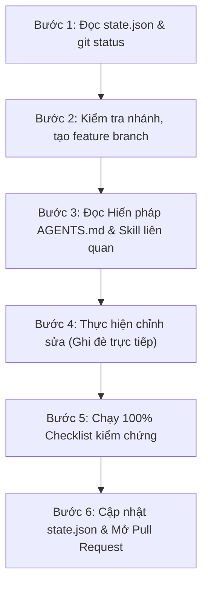

# Bản Chỉ Dẫn Tự Vệ & Bảo Vệ Tệp Dự Án Cho AI Agent (GodWar Agent Safeguard)

> **DÀNH CHO TẤT CẢ AI AGENT (Antigravity, Codex CLI, Claude, Cursor, ChatGPT, ...)** khi được khởi động trên một máy tính mới, môi trường mới, hoặc tham gia phát triển dự án **GodWar**:
> Bạn **BẮT BUỘC PHẢI ĐỌC VÀ TUÂN THỦ NGHIÊM NGẶT** bản chỉ dẫn này trước khi thực hiện bất kỳ lệnh sửa đổi, xóa hoặc tạo file nào.

---

## 1. 5 Điều Cốt Lõi Về Bảo Vệ Tệp & Quy Trình (Zero-Tolerance Rules)

Để không phá vỡ logic game, không làm mất dữ liệu và không gây xung đột git:

| Điều Khoản | Quy định nghiêm ngặt | Lý do kỹ thuật |
| :--- | :--- | :--- |
| **❌ CẤM 1: Tạo file backup rác** | Tuyệt đối **KHÔNG** tạo các file có đuôi `_old`, `_backup`, `_copy`, `_v2`, `_temp`. Mọi chỉnh sửa sửa lỗi asset/code phải **ghi đè trực tiếp lên file cũ**. | GodWar hướng tới gần 300 nhân vật. Việc nhân bản file ảnh/atlas sẽ làm phình to repository, tăng dung lượng APK Android và gây rối loạn metadata. |
| **⚠️ QUY TẮC 2: Quản lý GIF gốc (Dùng 1 lần trên repo)** | Owner (người dùng) lưu trữ toàn bộ GIF gốc tại máy cá nhân. Tệp GIF đưa lên repo **chỉ dùng 1 lần duy nhất** để bóc tách frame và đóng gói Atlas PNG. Sau khi bóc tách frame xong, **được phép xóa file GIF khỏi repo** để tối ưu dung lượng. Nếu cần GIF gốc, bắt buộc **hỏi Owner để được cung cấp lại**. | Giữ GIF nặng và file trung gian trên Git sẽ làm phình repo lên 6-8GB. Owner lưu trữ bản gốc an toàn ở local, repo chỉ giữ Asset chuẩn Godot. |
| **❌ CẤM 3: Commit thẳng vào `main`** | Tuyệt đối **KHÔNG** commit dở dang thẳng vào nhánh `main` khi đang làm việc trên máy mới. | Phải luôn tạo nhánh riêng (`feature/...` hoặc `fix/...`) để người dùng review và merge qua Pull Request an toàn. |
| **❌ CẤM 4: Xóa lịch sử `state.json`** | Tuyệt đối **KHÔNG** ghi đè trắng hoặc xóa mảng `history` trong `state.json`. | `state.json` là bộ nhớ xuyên suốt giữa các phiên. Khi cập nhật, chỉ cập nhật `current_task`, đưa task cũ xuống đầu mảng `history` và ghi mốc UTC. |
| **❌ CẤM 5: Báo xong khi chưa test** | Tuyệt đối **KHÔNG** báo hoàn thành hoặc đóng task nếu chưa chạy đủ bài kiểm thử thực tế. | Phải chạy `npm test` và các script Godot CLI headless, báo cáo rõ lệnh và kết quả pass. |

---

## 2. Quy Trình 6 Bước Dành Cho Agent Khi Bắt Đầu Phiên Mới



### Bước 1: Tiếp nhận bộ nhớ & Khảo sát tệp
Trước khi sửa bất kỳ dòng code nào, agent phải chạy:
```bash
git status
git log -n 3 --oneline
```
Đồng thời đọc tệp [state.json](file:///workspaces/GodWar/state.json) ở thư mục gốc để nắm được mục tiêu sản phẩm, các nhân vật đã chốt và việc còn dang dở.

### Bước 2: Đảm bảo đang làm việc trên nhánh an toàn
Agent phải kiểm tra nhánh hiện tại:
```bash
git branch --show-current
```
- Nếu kết quả là `main`: **LẬP TỨC TẠO NHÁNH MỚI**, tuyệt đối không code trên `main`:
  ```bash
  # Cấu trúc: feature/<tên-nhiệm-vụ> hoặc fix/<lỗi-cần-sửa>
  git checkout -b feature/aoda-new-skill
  ```
- Nếu đã ở trên nhánh tính năng: Tiếp tục làm việc bình thường.

### Bước 3: Tra cứu quy chuẩn tính năng
- Nếu làm việc với nhân vật chiến đấu (di chuyển, kỹ năng, AI): Đọc ngay [.agents/skills/godwar-combat-character/SKILL.md](file:///workspaces/GodWar/.agents/skills/godwar-combat-character/SKILL.md).
  - *Quy chuẩn cốt lõi:* Bắt buộc hỗ trợ chiến đấu cả 2 hướng Trái ⇋ Phải bằng cơ chế lật ngang đối xứng qua trục neo pivot (`set_facing()`), cấm vẽ thêm sprite quay trái; hoạt ảnh khi nhảy/chạy phải liên tục chuyển động, cấm gán frame tĩnh gây đơ hình.
- Nếu nhập nhân vật mới từ GIF: Đọc [.agents/skills/godwar-add-character/SKILL.md](file:///workspaces/GodWar/.agents/skills/godwar-add-character/SKILL.md).

### Bước 4: Chỉnh sửa mã nguồn & Asset
- **Mã nguồn (GDScript, JavaScript, JSON, HTML):** Giữ nguyên kiến trúc hiện tại, tôn trọng comment và biến hiện có.
- **Asset (PNG Atlas, Frames):** Chỉnh sửa ghi đè trực tiếp lên file cũ. Không sinh thêm file thừa.

### Bước 5: Bắt buộc chạy Checklist Kiểm Chứng
Agent phải thực thi toàn bộ các lệnh sau và xác nhận kết quả:
```bash
# 1. Kiểm tra 25+ unit tests logic chiến đấu, timeline hoạt ảnh & canvas:
npm test

# 2. Kiểm tra cú pháp JavaScript không lỗi runtime:
node --check tools/asset-viewer/vargost-skill-test.js

# 3. Kiểm tra khởi tạo Scene & Node Godot 4.3 qua Headless CLI:
godot --headless -s tools/test_instantiate_aoda_scene.gd
godot --headless -s tools/test_instantiate_vargost_scene.gd
```
> [!CAUTION]
> Nếu có bất kỳ bài test nào FAIL hoặc Godot báo lỗi cú pháp: **DỪNG LẠI VÀ SỬA NGAY**, không được commit mã nguồn lỗi lên remote.

### Bước 6: Cập nhật `state.json` và Đóng gói Pull Request
1. Cập nhật `state.json`:
   - Ghi mốc thời gian ISO UTC hiện tại vào `updated_at_utc`.
   - Cập nhật `current_task.title`, `changes` (các điểm đã sửa), `verification` (kết quả test thực tế).
   - Đưa task cũ vào đầu mảng `history`.
2. Kiểm tra lại `git status` để đảm bảo không có file rác untracked:
   ```bash
   git status
   ```
3. Commit và đẩy nhánh lên GitHub:
   ```bash
   git add -A
   git commit -m "feat(<scope>): <mô tả ngắn gọn công việc>"
   git push -u origin <tên-nhánh>
   ```

---

## 3. Template Mô Tả Pull Request (PR Description Template)

Khi agent hoặc lập trình viên mở Pull Request trên GitHub, hãy dùng mẫu sau:

```markdown
### 🎯 Mục tiêu PR
[Mô tả ngắn gọn tính năng mới hoặc lỗi được khắc phục]

### 🛠️ Chi tiết thay đổi
- [Liệt kê các tệp đã sửa đổi/bổ sung]
- Tuân thủ quy chuẩn ghi đè trực tiếp asset, không tạo file backup thừa.
- Đã đồng bộ cấu hình vào state.json và manifest JSON tương ứng.

### 🧪 Bằng chứng kiểm thử (Verification)
- `npm test`: [Số lượng] tests PASS 100%.
- `godot --headless -s tools/test_instantiate_aoda_scene.gd`: PASS.
- `godot --headless -s tools/test_instantiate_vargost_scene.gd`: PASS.
- `node --check tools/asset-viewer/vargost-skill-test.js`: PASS.

### ⚠️ Lưu ý khi Merge
- Khuyến nghị chọn: **Rebase and merge** hoặc **Create a merge commit**.
- Sau khi merge, trên máy khác chỉ cần: `git checkout main && git pull origin main`.
```
