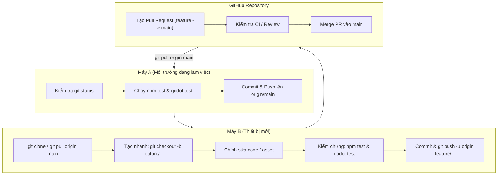

# Quy trình Đồng bộ Đa Máy & Tạo Pull Request An Toàn (GodWar PR Workflow)

Tài liệu này chuẩn hóa quy trình làm việc khi phát triển GodWar trên nhiều thiết bị khác nhau (ví dụ: chuyển đổi giữa GitHub Codespaces, PC làm việc ở nhà, laptop, hoặc phối hợp giữa các lập trình viên / AI agent), đảm bảo việc tạo Pull Request (PR) và hợp nhất (merge) diễn ra an toàn 100%, không gây xung đột dữ liệu hay phá vỡ logic game.

---

## 1. Trả lời Cốt lõi: Merge PR từ máy khác có bị ảnh hưởng gì không?

**Câu trả lời ngắn:** **Hoàn toàn KHÔNG bị ảnh hưởng** nếu tuân thủ đúng quy trình phân nhánh (branching) và chạy đủ kiểm thử trước khi merge.

Tuy nhiên, trong dự án GodWar có **4 rủi ro tiềm ẩn** bắt buộc phải quản lý:
1. **Máy gốc (hiện tại) chưa commit / push:** Nếu máy hiện tại đang có thay đổi ở working tree mà máy mới lại clone từ `origin/main` cũ, hai bên sẽ bị lệch pha và gây xung đột nghiêm trọng khi merge.
2. **Xung đột tệp bộ nhớ `state.json`:** Cả hai máy đều ghi nhật ký tiến độ vào `state.json`. Nếu không merge cẩn thận, thông tin bàn giao giữa các phiên sẽ bị đè mất.
3. **Xung đột tệp nhị phân (Binary Assets: PNG Atlas, GIF):** Git không thể tự động merge nội dung ảnh. Nếu hai máy cùng chỉnh sửa một file ảnh, Git sẽ báo lỗi binary conflict.
4. **Vi phạm Hiến pháp AGENTS.md:** Máy mới không được tùy tiện tạo các file backup `_old`, `_copy` làm phình to repository, và mọi tính năng mới phải tuân thủ chuẩn chiến đấu 2 hướng (`godwar-combat-character`).

---

## 2. Quy trình Chuẩn 4 Bước (Multi-Machine Git Flow)



---

### Bước 1: Đồng bộ sạch sẽ Máy A trước khi chuyển máy
Trước khi rời máy hiện tại:
1. Kiểm tra trạng thái:
   ```bash
   git status
   ```
2. Chạy bài kiểm tra tự động để đảm bảo nhánh đang xanh:
   ```bash
   npm test
   godot --headless -s tools/test_instantiate_aoda_scene.gd
   godot --headless -s tools/test_instantiate_vargost_scene.gd
   ```
3. Commit và đẩy toàn bộ lên nhánh `main`:
   ```bash
   git add -A
   git commit -m "feat/fix: <mô tả công việc đã hoàn thành>"
   git push origin main
   ```

---

### Bước 2: Thao tác trên Máy B (Máy mới)
1. Clone repository về máy (nếu chưa clone):
   ```bash
   git clone https://github.com/<user>/GodWar.git
   cd GodWar
   ```
   *(Nếu đã clone từ trước, luôn cập nhật bản mới nhất trước khi làm việc: `git checkout main && git pull origin main`).*

2. **Luôn tạo nhánh mới (Feature Branch):**
   ```bash
   # Đặt tên nhánh theo cấu trúc: feature/<tên-tính-năng> hoặc fix/<lỗi>
   git checkout -b feature/aoda-new-skill
   ```

3. Thực hiện chỉnh sửa mã nguồn hoặc asset:
   - Sửa trực tiếp lên asset cũ, không tạo file backup `_v2`, `_temp`.
   - Nếu chỉnh sửa nhân vật chiến đấu, đối chiếu với `.agents/skills/godwar-combat-character/SKILL.md`.

4. **Chạy Checklist Kiểm Chứng Bắt Buộc (Bảo hiểm 100%):**
   ```bash
   # 1. Kiểm tra toàn bộ test logic, hoạt ảnh và canvas
   npm test

   # 2. Kiểm tra cú pháp script JavaScript
   node --check tools/asset-viewer/vargost-skill-test.js

   # 3. Kiểm tra khởi tạo node Godot 4
   godot --headless -s tools/test_instantiate_aoda_scene.gd
   godot --headless -s tools/test_instantiate_vargost_scene.gd
   ```

5. Cập nhật `state.json` với mốc thời gian UTC và tóm tắt công việc đã làm trên nhánh này.

6. Commit và đẩy nhánh lên GitHub:
   ```bash
   git add -A
   git commit -m "feat(skill): add new skill for aoda"
   git push -u origin feature/aoda-new-skill
   ```

---

### Bước 3: Tạo và Hợp nhất Pull Request (PR)
1. Truy cập GitHub, bạn sẽ thấy thông báo nhánh mới vừa được push kèm nút **"Compare & pull request"**.
2. Điền thông tin PR theo mẫu:
   - **Tiêu đề:** Ngắn gọn, nêu bật tính năng (VD: `feat(aoda): tích hợp kỹ năng mới thay thế FireOrb`).
   - **Nội dung:**
     - Mô tả những thay đổi chính.
     - Xác nhận đã chạy `npm test` và `godot --headless` (kèm kết quả pass).
3. Bấm **"Create pull request"**.
4. **Hợp nhất (Merge):**
   - Khuyến nghị chọn: **Rebase and merge** hoặc **Create a merge commit** để bảo tồn lịch sử commit chi tiết.
   - Bấm **"Confirm merge"**. Nhánh tính năng sẽ được gộp vào `main` một cách an toàn.

---

### Bước 4: Đồng bộ trở lại Máy A (hoặc bất kỳ máy nào)
Khi quay lại làm việc trên Máy A:
```bash
git checkout main
git pull origin main
npm test
```
Toàn bộ mã nguồn, asset và trạng thái đã được đồng bộ tuyệt đối giữa 2 máy.

---

## 3. Cẩm nang Xử lý Xung đột (Conflict Resolution)

### 1. Xung đột tệp bộ nhớ `state.json`
Nếu cả 2 máy cùng sửa `state.json` dẫn đến conflict khi pull/merge:
- **Cách xử lý:**
  1. Mở `state.json`.
  2. Phần `current_task`: Lấy task mới nhất theo mốc `updated_at_utc`.
  3. Phần `history`: Nối tiếp mảng lịch sử của cả 2 phía lại với nhau, không xóa bất kỳ task nào của phía kia.
  4. Kiểm tra JSON hợp lệ: `python3 -m json.tool state.json > /dev/null`.

### 2. Xung đột tệp nhị phân Asset (PNG Atlas, GIF, MP4)
- Git sẽ báo: `CONFLICT (content): Merge conflict in Asset/.../atlas.png`.
- **Cách xử lý:**
  1. Kiểm tra trực quan xem bản nào đã được kiểm chứng hoạt động tốt trên Asset Viewer (localhost:4173).
  2. Chọn bản mong muốn:
     - Giữ bản của nhánh hiện tại: `git checkout --ours Asset/.../atlas.png`
     - Lấy bản từ nhánh merge vào: `git checkout --theirs Asset/.../atlas.png`
  3. Chạy lại `npm test` để xác nhận asset khớp với metadata frame.

---

## 4. Checklist Nhanh Trước Khi Đóng Phiên (Handover Checklist)

- [ ] `git status` sạch sẽ, không còn file tạm/untracked thừa.
- [ ] `npm test` đạt 100% PASS.
- [ ] Node Godot CLI khởi tạo thành công (`exit code 0`).
- [ ] `state.json` đã cập nhật mốc thời gian UTC và mô tả ngắn gọn.
- [ ] Đã chạy `git push` lên GitHub remote.
